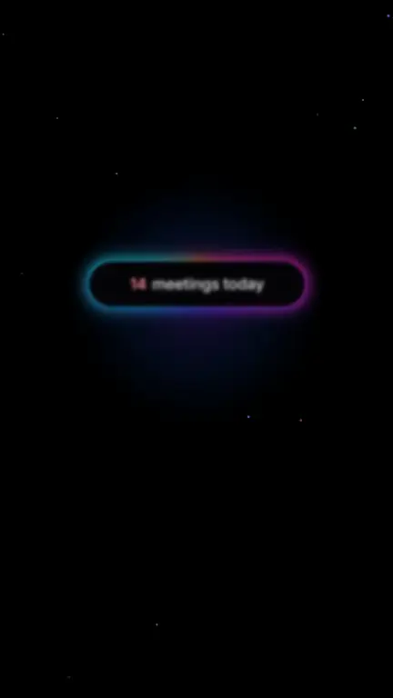
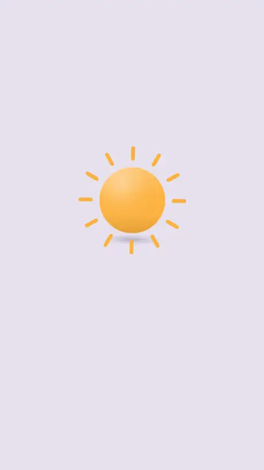
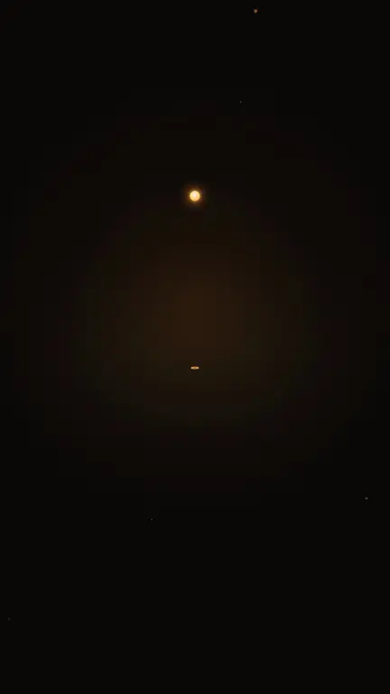

# MotionKit

**A motion-graphics skill and kit for Claude Code that makes premium, liquid, cut-free product films in code with [HyperFrames](https://github.com/heygen-com/hyperframes). It was distilled from 60 reference films and refined over five rounds of human review.**

MotionKit is the knowledge a motion designer carries in their head, written down so an AI agent can use it. That covers how great product films move, how their cameras travel, what their elements are made of, which fonts and colours they use, and how they sit on the music. It is packaged as a Claude Code skill plus code primitives, a premium element library, four sample films and the measurement tools used to check every render.

<p align="center">
<a href="media/d-saas-tally.mp4"></a><br/>
<sub><b>Tally</b> · 16:9 · 27 s · breathing-gradient SaaS: a travelling follow-cam over kinetic type, alternating with element beats</sub>
</p>

<table>
<tr>
<td width="33%" align="center"><a href="media/c-neon-aura.mp4"></a><br/><sub><b>Aura</b> · 9:16 · 27 s · neon rim glow</sub></td>
<td width="33%" align="center"><a href="media/b-morph-nook.mp4"></a><br/><sub><b>Nook</b> · 9:16 · 26 s · morph continuum</sub></td>
<td width="33%" align="center"><a href="media/a-ember-lumen.mp4"></a><br/><sub><b>Lumen</b> · 9:16 · 31 s · ember flow</sub></td>
</tr>
</table>

<sub>The previews play each film in full, start to finish. Click a preview for the MP4. Every frame of these films is HTML/CSS/SVG + GSAP rendered by HyperFrames, with no After Effects and no stock footage. The demo files are <b>muted</b>, because the films were cut to third-party reference tracks that can't be redistributed. Bring your own music (see <a href="#music">Music</a>).</sub>

---

## How it was made: trained, tested, revised

MotionKit is not a prompt template. It came out of a loop of study, build, measure and get critiqued:

1. **Study.** 60 premium motion films (Apple-style morph films, AI-lab launch spots, SaaS explainers, kinetic-type reels, lyric films) were watched frame by frame. Each got timestamped contact sheets, 10 fps strips across every transition, and written notes on its elements, palette, type, camera and every transition (`research/video-notes/`).
2. **Measure.** Purpose-built tools turned taste into numbers: hard cuts per 10 s, how much and how smoothly the camera moves (`camera_motion.py`, `camera_moves.py`, `camera_velocity.py`), and how tightly visual events land on the music (`sync_check.py`). For example, 19 of the 59 motion references contain zero hard cuts. In text-driven films the camera is moving 65–87 % of the time. And visual events land on audio hits 1.15–1.4× more often than chance.
3. **Distil.** The findings became a grammar (continuity carriers, easing, kinetic type, materials, camera, sync), 12 style cards, code primitives and an element library.
4. **Build and review: five rounds.** Four sample films were built, then reviewed by a human with a high bar. Each round's critique was turned into a rule, a primitive and a regression check:

| Round | Reviewer's note | What changed in the kit |
|---|---|---|
| 1 | "Pop-in stickers look cheap", "no unprofessional glows", "look at the corners", **"NO CINEMATIC CAMERA MOVEMENT"** | `09-polish-bar.md`: tight glows only, geometry morphs (corners stay round every frame), no scale-pops on UI. `camera-rig.js` added. |
| 2 | "It's just the perspective; the camera isn't *moving*", "use professional elements, contrast, fonts" | Camera must *travel* (follow-cam over a world bigger than the frame). `research/camera-notes.md` written from 20 camera-heavy references. `elements/` library and `fonts/` added. |
| 3 | "The camera is incremental, 5 px stop 5 px stop", "camera movement only where there's text; morph films become chaos", "the pattern is predictable" | Spline **glide** keys (one continuous move per phrase). Rule: *decide the camera from the content*. Element films get a near-locked camera with motivated, **seeded** moves. |
| 4 | "Constantly left to right", "balance camera with element interaction", "sync with the beats" | Varied routes (never the same direction twice in a row), camera beats alternating with element beats, `beat-sync.js` + `sync_check.py`. |
| 5 | Final pass, measured | Beat-sync lift: Tally ×1.65, Nook ×1.62, Aura ×1.41, Lumen ×1.22 (the references score ×1.15–1.41). Zero hard cuts in all four films. |

The full critique history and the reasoning behind every rule live in `grammar/` and `research/`.

---

## What's inside

```
skill/SKILL.md              The Claude Code skill: non-negotiables, workflow, quick references
grammar/                    The motion grammar (read in order)
  01-continuity.md            14 "carriers" that replace hard cuts
  02-motion-easing.md         liquid laws, ease palette, timings, beat math
  03-kinetic-type.md          24 kinetic-type patterns
  04-materials-effects.md     glass, reeded glass, rim-light, metaballs, orbs, grain + palettes
  05-camera-ui-story.md       UI choreography, story structures, endings
  06-audio-sync.md            how tracks were analysed and paired with styles
  07-engineering-pitfalls.md  22 seek-safety and polish bugs (and fixes)
  08-camera.md                the camera doctrine: content decides camera, glide, seeds, routes, sync
  09-polish-bar.md            everything the reviewer rejected, as hard rules
styles/STYLES.md            12 style cards (tokens, signature moves, references, camera, music pairing)
primitives/
  PRIMITIVES.md               22 copy-paste blocks proven in the samples
  camera-rig.js               seek-safe 3D camera: eased/glide keys, seeded drift, DOF
  beat-sync.js                snap a scene's events to the music without hand-retiming
elements/                   premium element library (elements.css/.js) + showcase/ project
fonts/                      OFL fonts + fonts.css + FONTS.md pairing guide + fetch-fontshare.sh
research/
  INDEX.md                    all 60 references: style, format, cuts, motion, camera %, rating
  video-notes/                per-reference breakdowns
  camera-notes.md, element-notes.md
  camera_motion.py, camera_moves.py, camera_velocity.py, sync_check.py, audio_hits.py
samples/                    four HyperFrames projects (Lumen, Nook, Aura, Tally), fully editable
media/                      muted demo renders + previews
```

---

## Quick start

### 1 · Requirements
- [Claude Code](https://claude.com/claude-code)
- Node 18+ and `npx` (HyperFrames runs via `npx hyperframes …`)
- `ffmpeg` / `ffprobe`, plus Python 3 with `numpy` and `Pillow` for the research tools
- The HyperFrames skills: `npx hyperframes skills update`

### 2 · Install the skill
```bash
git clone https://github.com/DyneStein/motionkit.git
cd motionkit
ln -s "$PWD/skill" ~/.claude/skills/motionkit      # Claude Code picks it up as the "motionkit" skill
fonts/fetch-fontshare.sh                            # optional: Chillax, Satoshi, General Sans, Clash Grotesk…
```

### 3 · Ask for a film
In Claude Code:

> *"Make a 25-second vertical launch reel for my app **Orbit** (a calm calendar), MotionKit style, using `~/music/track.mp3`."*

The skill picks a style from `styles/STYLES.md` and analyses your track. It decides the camera from the content: travelling glides for text-heavy films, a near-locked camera with motivated moves for element films. It then plans a varied route that alternates camera and element beats, builds with HyperFrames from the closest sample, syncs events to your music, and checks the render.

### 4 · Or start from a sample yourself
```bash
cp -R samples/c-neon-aura my-film && cd my-film
cp ~/music/track.mp3 assets/music.mp3
python3 ../research/audio_hits.py assets/music.mp3 27      # paste into HITS in compositions/neon.html
npx hyperframes preview --background                       # edit live in the browser Studio
npx hyperframes render -o my-film.mp4
```

### 5 · Check your render like the kit does
```bash
python3 research/sync_check.py my-film.mp4                       # beat-sync lift (aim ≥ ×1.35)
python3 research/camera_velocity.py my-film.mp4 3.0 7.0          # smoothness of a camera move
python3 research/camera_moves.py my-film.mp4                     # direction/speed of every move
```

---

## The core ideas

- **Never cut. Carry.** Every scene change is carried by something that exists on both sides of the seam: an element that becomes the world, a morph, a guide object, an iris, a zoom-through (`grammar/01`).
- **Decide the camera from the content.** Text builds get a travelling camera that *glides*, one continuous spline per phrase and never per-word hops. Element films keep the camera still and move it only when something motivates it. Routes vary direction, and drift is seeded so nothing feels predictable (`grammar/08`).
- **Polish is a material discipline.** Tight glows, never halos. Corners stay round in every frame because morphs are geometry, not clip-paths. UI arrives from depth and focus and never pops. Shadows are wide, soft and tinted. Professional faces with tight tracking (`grammar/09`, `research/element-notes.md`).
- **Land on the music.** Use the beat grid for rhythmic tracks and `beatSync()` to strong hits for ambient ones (`grammar/08 §5`).

---

## Music

MotionKit **never generates music**: synthetic beds sound robotic next to real tracks. Supply your own licensed or original music. The samples expect `assets/music.mp3` (see each `assets/MUSIC.md`). After swapping tracks, regenerate the hit list or beat grid as shown above.

## Credits and licensing

- Code, docs and grammar: **MIT** (see `LICENSE`).
- Fonts: OFL faces are bundled under the SIL Open Font License (`fonts/OFL-NOTICE.md`). Fontshare faces are fetched, not bundled.
- Reference films were studied for analysis only. No reference footage, frames or audio are included, and all brands in the samples (Lumen, Nook, Aura, Tally) are fictional.
- Rendering by [HyperFrames](https://github.com/heygen-com/hyperframes), animation by [GSAP](https://gsap.com).

Contributions are welcome: new style cards, primitives, element pieces, or a new review round's findings.
